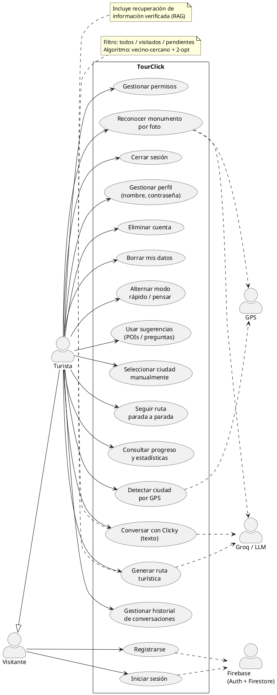

# Anexo A1 — Especificaciones del sistema

**Proyecto:** TourClick — Asistente turístico inteligente para ciudades patrimoniales
**Documento:** Especificación de requisitos del software (SRS)

---

## Índice

1. [Introducción](#1-introducción)
   1. [Propósito](#11-propósito)
   2. [Ámbito del sistema](#12-ámbito-del-sistema)
   3. [Definiciones, acrónimos y abreviaturas](#13-definiciones-acrónimos-y-abreviaturas)
2. [Descripción general](#2-descripción-general)
   1. [Perspectiva del producto](#21-perspectiva-del-producto)
   2. [Actores del sistema](#22-actores-del-sistema)
   3. [Características de los usuarios](#23-características-de-los-usuarios)
   4. [Restricciones generales](#24-restricciones-generales)
   5. [Suposiciones y dependencias](#25-suposiciones-y-dependencias)
3. [Especificación de requisitos mediante historias de usuario](#3-especificación-de-requisitos-mediante-historias-de-usuario)
   1. [Épicas](#31-épicas)
   2. [Historias de usuario y criterios de aceptación](#32-historias-de-usuario-y-criterios-de-aceptación)
4. [Requisitos funcionales](#4-requisitos-funcionales)
5. [Requisitos no funcionales](#5-requisitos-no-funcionales)
6. [Reglas de negocio](#6-reglas-de-negocio)
7. [Diagrama general de casos de uso](#7-diagrama-general-de-casos-de-uso)
8. [Matriz de trazabilidad](#8-matriz-de-trazabilidad)

---

## 1. Introducción

### 1.1 Propósito

Este anexo especifica de forma detallada los **requisitos funcionales y no funcionales**
del sistema TourClick. Constituye el documento base sobre el que se realiza el análisis y
el diseño (Anexo A2). Está dirigido al tribunal evaluador del TFG, a futuros
desarrolladores que mantengan o amplíen el sistema y al propio autor como contrato de lo
que el software debe hacer.

La especificación combina dos enfoques complementarios:

- **Ágil**: *historias de usuario* con criterios de aceptación y priorización **MoSCoW**,
  que describen el valor desde el punto de vista del usuario.
- **Clásico (IEEE-830)**: catálogo numerado de *requisitos funcionales* (RF) y *no
  funcionales* (RNF), que permite la trazabilidad y la verificación.

### 1.2 Ámbito del sistema

TourClick es un sistema software compuesto por:

- Una **aplicación móvil** (Flutter, Android/Web) que es el punto de contacto con el
  turista.
- Un **servidor de aplicaciones** (FastAPI) que orquesta los servicios de inteligencia
  artificial: conversación con un LLM, recuperación de información (RAG), reconocimiento
  de monumentos por imagen y generación de rutas.
- Servicios externos: **Firebase** (autenticación y base de datos) y **Groq** (inferencia
  del modelo de lenguaje).

El sistema **permite**: registrarse e iniciar sesión; conversar con un guía virtual sobre
el patrimonio de una ciudad; identificar monumentos fotografiándolos; recibir rutas a pie
personalizadas; llevar un registro de los monumentos visitados y consultar estadísticas de
progreso.

El sistema **no aborda**: reservas o pagos, recomendaciones de restauración u ocio
(redirige deliberadamente al patrimonio), navegación GPS turn-by-turn, ni soporte de
ciudades sin catálogo y modelo entrenado (de momento solo Salamanca).

### 1.3 Definiciones, acrónimos y abreviaturas

| Término | Significado |
|---|---|
| **LLM** | *Large Language Model*. Modelo de lenguaje (Llama 3.3 70B vía Groq). |
| **RAG** | *Retrieval-Augmented Generation*. Generación aumentada con recuperación de información. |
| **POI** | *Point of Interest*. Punto de interés / monumento. |
| **MVVM** | *Model–View–ViewModel*. Patrón de arquitectura del cliente. |
| **SRS** | *Software Requirements Specification*. |
| **GPS** | Sistema de geolocalización del dispositivo. |
| **MoSCoW** | Priorización *Must / Should / Could / Won't*. |
| **Clicky** | Identidad del asistente conversacional. |
| **Modo rápido / pensar** | Estrategias de respuesta de baja latencia / razonamiento con herramientas. |

> Glosario ampliado del dominio en [`modelo_dominio.md`](./modelo_dominio.md).

---

## 2. Descripción general

### 2.1 Perspectiva del producto

TourClick es un producto **nuevo y autónomo**, no integrado en un sistema mayor. Sigue una
arquitectura **cliente-servidor** con servicios de IA en el backend y persistencia
delegada en la nube (Firebase). El cliente es responsable de la experiencia de usuario y
de la lógica de presentación; el servidor concentra la inteligencia (LLM, visión, rutas).

### 2.2 Actores del sistema

| Actor | Tipo | Descripción |
|---|---|---|
| **Visitante** | Primario (humano) | Usuario no autenticado. Solo puede registrarse o iniciar sesión. |
| **Turista** | Primario (humano) | Usuario autenticado. Es el actor principal: conversa, fotografía, genera rutas y consulta su progreso. |
| **Servicio de autenticación (Firebase Auth)** | Secundario (sistema) | Gestiona el alta, login, reautenticación y borrado de credenciales. |
| **Base de datos (Cloud Firestore)** | Secundario (sistema) | Persiste usuarios, conversaciones, mensajes y progreso en tiempo real. |
| **Proveedor de IA (Groq / Llama 3.3)** | Secundario (sistema) | Ejecuta la inferencia del modelo de lenguaje y el *tool-calling*. |
| **Sensor de ubicación (GPS)** | Secundario (dispositivo) | Proporciona las coordenadas para detectar y validar la ciudad. |

### 2.3 Características de los usuarios

El usuario objetivo es un **turista cultural** sin conocimientos técnicos, que utiliza la
aplicación *in situ* mientras pasea por la ciudad, frecuentemente con una sola mano y bajo
condiciones variables de conectividad y luz. De ello se derivan exigencias de
**usabilidad**, **inmediatez** y **tolerancia a fallos** recogidas en los RNF.

### 2.4 Restricciones generales

- **CR-01** — El cliente se desarrolla en **Flutter/Dart** y se despliega en Android y Web.
- **CR-02** — El servidor se desarrolla en **Python/FastAPI**.
- **CR-03** — La autenticación y la base de datos se realizan sobre **Firebase**.
- **CR-04** — La inferencia del LLM depende de la **API de Groq** y requiere clave válida.
- **CR-05** — El reconocimiento de monumentos requiere los ficheros de modelo
  (DINOv2 ONNX + clasificador) y la base vectorial (ChromaDB) presentes en el servidor.
- **CR-06** — Solo se soportan ciudades con catálogo y modelo entrenado (actualmente
  **Salamanca**).
- **CR-07** — La interfaz y las respuestas del asistente son en **español**.

### 2.5 Suposiciones y dependencias

- El usuario dispone de un dispositivo con cámara y, deseablemente, GPS.
- Existe conectividad a Internet para autenticación, conversación y reconocimiento.
- Los servicios externos (Firebase, Groq) están operativos y dentro de sus cuotas.

---

## 3. Especificación de requisitos mediante historias de usuario

Priorización **MoSCoW**: **M** (imprescindible), **S** (recomendable), **C** (opcional),
**W** (fuera de alcance actual).

### 3.1 Épicas

| ID | Épica | Descripción |
|---|---|---|
| **E1** | Gestión de cuenta | Registro, acceso y administración del perfil y los datos del usuario. |
| **E2** | Conversación con el guía | Diálogo con Clicky sobre el patrimonio, en modos rápido y pensar. |
| **E3** | Reconocimiento de monumentos | Identificación de monumentos a partir de fotografías. |
| **E4** | Geolocalización y ciudades | Detección y validación de la ciudad activa por GPS. |
| **E5** | Rutas turísticas | Generación y seguimiento de itinerarios a pie. |
| **E6** | Progreso y gamificación | Registro de monumentos visitados y estadísticas. |
| **E7** | Historial y conversaciones | Gestión del histórico de chats y de la navegación entre ellos. |
| **E8** | Ajustes y permisos | Gestión de permisos del dispositivo y preferencias. |

### 3.2 Historias de usuario y criterios de aceptación

> Formato: **Como** [rol] **quiero** [acción] **para** [beneficio]. CA = criterios de
> aceptación.

#### E1 — Gestión de cuenta

**HU-01 (M)** — Como **visitante**, quiero **registrarme con correo, contraseña y nombre**
para tener una cuenta personal.
- CA1: El nombre, el correo y la contraseña son obligatorios.
- CA2: La contraseña debe tener al menos 8 caracteres.
- CA3: Si el correo ya está registrado o tiene formato inválido, se muestra un mensaje claro.
- CA4: Tras el alta, se crea el perfil del usuario y se accede a la pantalla principal.

**HU-02 (M)** — Como **visitante**, quiero **iniciar sesión** para acceder a mis datos.
- CA1: Con credenciales válidas se entra a la pantalla principal.
- CA2: Con credenciales inválidas se informa del error sin revelar cuál de los dos campos falla.
- CA3: Tras varios intentos fallidos se avisa de que espere unos minutos.

**HU-03 (M)** — Como **turista**, quiero **cerrar sesión** para proteger mi cuenta en
dispositivos compartidos.
- CA1: Al cerrar sesión se vuelve a la pantalla de acceso y se bloquea el acceso a rutas privadas.

**HU-04 (S)** — Como **turista**, quiero **cambiar mi nombre de usuario** para personalizar mi perfil.
- CA1: El nombre debe tener al menos 3 caracteres.
- CA2: El cambio se refleja en perfil y panel lateral tras guardarlo.

**HU-05 (S)** — Como **turista**, quiero **cambiar mi contraseña** para mantener mi cuenta segura.
- CA1: Se exige la contraseña actual (reautenticación).
- CA2: La nueva debe tener ≥ 8 caracteres y ser distinta de la actual.

**HU-06 (S)** — Como **turista**, quiero **eliminar mi cuenta** para ejercer mi derecho al olvido.
- CA1: Se exige reautenticación con contraseña.
- CA2: Se eliminan los chats del usuario y, finalmente, la credencial.

**HU-07 (S)** — Como **turista**, quiero **borrar mis datos** (chats y progreso) sin
eliminar la cuenta, para empezar de cero.
- CA1: Se borran todas las conversaciones y todo el progreso de ciudades.
- CA2: La cuenta permanece activa.

#### E2 — Conversación con el guía

**HU-08 (M)** — Como **turista**, quiero **escribir preguntas a Clicky** y recibir
respuestas sobre el patrimonio para informarme mientras paseo.
- CA1: La respuesta llega en lenguaje natural y en español.
- CA2: Si no hay ciudad activa, el sistema la determina (GPS) o la solicita antes de responder.
- CA3: Si el servidor no responde, se muestra un mensaje de error amable y reintentable.

**HU-09 (M)** — Como **turista**, quiero **alternar entre un modo rápido y un modo
detallado (“pensar”)** para equilibrar inmediatez y profundidad.
- CA1: En **modo rápido** las respuestas son breves (2-3 frases) y de baja latencia.
- CA2: En **modo pensar** el asistente puede consultar información verificada antes de
  responder y elaborar más (4-6 frases).
- CA3: El modo seleccionado se mantiene hasta que el usuario lo cambie.

**HU-10 (M)** — Como **turista**, quiero que **las respuestas se basen en información
verificada** del monumento por el que pregunto, para evitar datos inventados.
- CA1: Cuando se reconoce un monumento (por texto o foto), la respuesta usa sus datos verificados (RAG).
- CA2: El asistente no inventa fechas, cifras ni nombres ausentes en la información recuperada.

**HU-11 (C)** — Como **turista**, quiero **tocar sugerencias de monumentos cercanos o de
curiosidades** para continuar la conversación sin teclear.
- CA1: Tras reconocer un monumento aparecen chips de POIs cercanos o de preguntas.
- CA2: Al pulsar un chip se envía la consulta correspondiente automáticamente.

**HU-12 (S)** — Como **turista**, quiero que **el guía no se salga de su papel** aunque yo
intente manipularlo, para una experiencia coherente y segura.
- CA1: Ante peticiones de revelar sus instrucciones, cambiar de rol o ignorar reglas, se
  niega amablemente y reconduce al turismo.

#### E3 — Reconocimiento de monumentos

**HU-13 (M)** — Como **turista**, quiero **fotografiar un monumento y que la app lo
identifique** para saber qué estoy viendo.
- CA1: Se acepta foto de cámara o de galería.
- CA2: El sistema devuelve el nombre del monumento y una descripción breve.
- CA3: Si la confianza es baja, se indica que no se ha reconocido el lugar.

**HU-14 (S)** — Como **turista**, quiero que **la foto se conserve en la conversación**
para revisarla después.
- CA1: La imagen se guarda de forma persistente y se muestra al recargar el chat.

**HU-15 (S)** — Como **turista**, quiero que **la app rechace fotos fuera de la ciudad
activa** para que el reconocimiento sea coherente con dónde estoy.
- CA1: Si el dispositivo está fuera del radio de la ciudad, se informa y no se procesa.
- CA2: Si no puede validarse la ubicación, se permite continuar (no bloquear por fallo de GPS).

#### E4 — Geolocalización y ciudades

**HU-16 (M)** — Como **turista**, quiero que **la app detecte automáticamente la ciudad en
la que estoy** para no tener que elegirla.
- CA1: Con permiso de ubicación, se asigna la ciudad soportada en cuyo radio me encuentro.
- CA2: Si no hay ninguna ciudad soportada cerca, se informa.

**HU-17 (S)** — Como **turista**, quiero **seleccionar la ciudad manualmente** cuando no
tengo GPS para poder usar la app igualmente.
- CA1: Si no hay GPS ni ciudad, se ofrece un selector de ciudades soportadas.

#### E5 — Rutas turísticas

**HU-18 (M)** — Como **turista**, quiero **pedir una ruta a pie por los monumentos** para
organizar mi visita.
- CA1: Puedo elegir entre incluir **todos**, solo **pendientes** o solo **visitados**.
- CA2: La ruta se ordena por proximidad partiendo de mi posición.
- CA3: Se muestra un resumen con número de paradas y tiempo total estimado a pie.

**HU-19 (S)** — Como **turista**, quiero **seguir la ruta parada a parada** confirmando con
una foto al llegar, para avanzar de forma guiada.
- CA1: El sistema indica la parada actual y avanza a la siguiente al fotografiar el monumento.
- CA2: Al completar la última parada, se notifica el fin de la ruta.

#### E6 — Progreso y gamificación

**HU-20 (M)** — Como **turista**, quiero que **se registren los monumentos que voy
capturando** para llevar la cuenta de lo que he visto.
- CA1: Al reconocer un monumento por foto, queda marcado como visitado en su ciudad.

**HU-21 (S)** — Como **turista**, quiero **consultar mis estadísticas** (chats, mensajes,
ciudades, POIs y progreso por ciudad) para ver mi avance.
- CA1: Se muestran totales y el porcentaje de monumentos capturados por ciudad.

**HU-22 (C)** — Como **turista**, quiero **desmarcar un POI** o **eliminar una ciudad
visitada** para corregir mi progreso.
- CA1: Puedo poner un POI como no visitado.
- CA2: Puedo borrar todo el progreso de una ciudad.

#### E7 — Historial y conversaciones

**HU-23 (M)** — Como **turista**, quiero **un historial de conversaciones** para retomar
diálogos anteriores.
- CA1: El panel lateral lista mis chats recientes con su título.
- CA2: Al pulsar uno se abre con todos sus mensajes.

**HU-24 (S)** — Como **turista**, quiero **iniciar una conversación nueva** para tratar un
tema distinto.

**HU-25 (S)** — Como **turista**, quiero **eliminar una conversación** para depurar mi
historial.
- CA1: Al borrar un chat se eliminan sus mensajes y las imágenes asociadas.

**HU-26 (C)** — Como **turista**, quiero que **cada chat reciba un título representativo
automáticamente** para reconocerlo de un vistazo.
- CA1: El título se deriva del primer texto significativo o del monumento fotografiado.

#### E8 — Ajustes y permisos

**HU-27 (S)** — Como **turista**, quiero **gestionar los permisos** de ubicación, cámara y
galería desde la app para controlar mi privacidad.
- CA1: Se muestra el estado de cada permiso y se puede solicitar o abrir los ajustes del sistema.

---

## 4. Requisitos funcionales

> Catálogo IEEE-830. Cada RF se vincula a su historia de usuario y caso de uso.

### 4.1 Subsistema de autenticación y cuenta

| ID | Requisito | Prioridad | HU |
|---|---|---|---|
| **RF-01** | El sistema permitirá registrar un usuario con nombre, correo y contraseña. | M | HU-01 |
| **RF-02** | El sistema validará que la contraseña tenga al menos 8 caracteres en el registro. | M | HU-01 |
| **RF-03** | El sistema permitirá iniciar sesión con correo y contraseña. | M | HU-02 |
| **RF-04** | El sistema traducirá los errores de autenticación a mensajes comprensibles en español. | M | HU-01/02 |
| **RF-05** | El sistema permitirá cerrar la sesión activa. | M | HU-03 |
| **RF-06** | El sistema permitirá modificar el nombre de usuario (mínimo 3 caracteres). | S | HU-04 |
| **RF-07** | El sistema permitirá cambiar la contraseña previa reautenticación. | S | HU-05 |
| **RF-08** | El sistema permitirá eliminar la cuenta previa reautenticación, borrando los chats. | S | HU-06 |
| **RF-09** | El sistema permitirá borrar todos los datos del usuario (chats y progreso) sin eliminar la cuenta. | S | HU-07 |

### 4.2 Subsistema de conversación (asistente IA)

| ID | Requisito | Prioridad | HU |
|---|---|---|---|
| **RF-10** | El sistema permitirá enviar mensajes de texto al asistente y recibir respuestas en lenguaje natural. | M | HU-08 |
| **RF-11** | El sistema ofrecerá dos modos de respuesta: **rápido** (breve, baja latencia) y **pensar** (razonado, con herramientas). | M | HU-09 |
| **RF-12** | En modo pensar, el asistente decidirá de forma autónoma cuándo invocar las herramientas `usar_rag` y `generar_ruta`. | M | HU-09/10/18 |
| **RF-13** | El sistema recuperará información verificada (RAG) del monumento detectado y la usará como base de la respuesta. | M | HU-10 |
| **RF-14** | El sistema detectará el monumento mencionado en el texto del usuario mediante alias y clases. | M | HU-08/10 |
| **RF-15** | El sistema enviará como contexto los últimos mensajes de texto de la conversación (historial acotado). | S | HU-08 |
| **RF-16** | El sistema mostrará chips de POIs cercanos o de preguntas tras reconocer un monumento. | C | HU-11 |
| **RF-17** | El sistema rechazará intentos de fuga de instrucciones o cambio de rol del asistente. | S | HU-12 |
| **RF-18** | El sistema mantendrá un único monumento «activo» de contexto entre mensajes consecutivos. | S | HU-08/10 |

### 4.3 Subsistema de reconocimiento de monumentos

| ID | Requisito | Prioridad | HU |
|---|---|---|---|
| **RF-19** | El sistema permitirá subir una imagen desde cámara o galería para su clasificación. | M | HU-13 |
| **RF-20** | El sistema clasificará la imagen y devolverá el monumento identificado o un valor «desconocido» bajo umbral de confianza. | M | HU-13 |
| **RF-21** | El sistema devolverá nombre, descripción breve, coordenadas y POIs cercanos del monumento reconocido. | M | HU-13 |
| **RF-22** | El sistema almacenará la imagen enviada de forma persistente y la mostrará en la conversación. | S | HU-14 |
| **RF-23** | En modo pensar, el sistema reformulará la descripción del monumento reconocido con el LLM. | C | HU-13 |

### 4.4 Subsistema de geolocalización y ciudades

| ID | Requisito | Prioridad | HU |
|---|---|---|---|
| **RF-24** | El sistema obtendrá la lista de ciudades soportadas del servidor, con respaldo local si no responde. | M | HU-16 |
| **RF-25** | El sistema detectará la ciudad activa comparando la posición GPS con el radio de cada ciudad. | M | HU-16 |
| **RF-26** | El sistema permitirá seleccionar la ciudad manualmente si no hay GPS ni ciudad detectada. | S | HU-17 |
| **RF-27** | El sistema validará que las fotos se tomen dentro del radio de la ciudad activa (fail-open). | S | HU-15 |

### 4.5 Subsistema de rutas turísticas

| ID | Requisito | Prioridad | HU |
|---|---|---|---|
| **RF-28** | El sistema generará una ruta a pie ordenada por proximidad a partir de la posición del usuario. | M | HU-18 |
| **RF-29** | El sistema permitirá filtrar las paradas de la ruta por: todos, visitados o pendientes. | M | HU-18 |
| **RF-30** | El sistema calculará distancia y tiempo a pie de cada tramo y el tiempo total. | M | HU-18 |
| **RF-31** | El sistema generará un resumen narrado de la ruta. | S | HU-18 |
| **RF-32** | El sistema guiará la ruta parada a parada, avanzando al fotografiar cada monumento. | S | HU-19 |
| **RF-33** | El sistema notificará la finalización de la ruta al completar la última parada. | S | HU-19 |

### 4.6 Subsistema de progreso y estadísticas

| ID | Requisito | Prioridad | HU |
|---|---|---|---|
| **RF-34** | El sistema sembrará el catálogo de monumentos de una ciudad la primera vez que se visita (idempotente). | M | HU-20 |
| **RF-35** | El sistema marcará un monumento como visitado al reconocerlo por foto. | M | HU-20 |
| **RF-36** | El sistema calculará estadísticas agregadas: chats, mensajes, media, ciudades, POIs y progreso por ciudad. | S | HU-21 |
| **RF-37** | El sistema permitirá desmarcar un POI visitado. | C | HU-22 |
| **RF-38** | El sistema permitirá eliminar el progreso completo de una ciudad. | C | HU-22 |

### 4.7 Subsistema de conversaciones e historial

| ID | Requisito | Prioridad | HU |
|---|---|---|---|
| **RF-39** | El sistema persistirá las conversaciones y mensajes por usuario y los mostrará en tiempo real. | M | HU-23 |
| **RF-40** | El sistema listará el historial de conversaciones recientes en el panel lateral. | M | HU-23 |
| **RF-41** | El sistema permitirá abrir una conversación del historial con todos sus mensajes. | M | HU-23 |
| **RF-42** | El sistema permitirá crear una nueva conversación. | S | HU-24 |
| **RF-43** | El sistema permitirá eliminar una conversación junto con sus mensajes e imágenes. | S | HU-25 |
| **RF-44** | El sistema asignará automáticamente un título representativo a cada conversación. | C | HU-26 |

### 4.8 Subsistema de ajustes y permisos

| ID | Requisito | Prioridad | HU |
|---|---|---|---|
| **RF-45** | El sistema mostrará y permitirá solicitar los permisos de ubicación, cámara y galería. | S | HU-27 |
| **RF-46** | El sistema permitirá abrir los ajustes del sistema operativo si un permiso está denegado permanentemente. | S | HU-27 |

---

## 5. Requisitos no funcionales

### 5.1 Usabilidad

| ID | Requisito |
|---|---|
| **RNF-01** | La interfaz y todas las respuestas del asistente serán en **español**. |
| **RNF-02** | Las respuestas del modo rápido se limitarán a 2-3 frases para favorecer la lectura *in situ*. |
| **RNF-03** | La app será operable con una sola mano: acciones principales (enviar, foto, modo) accesibles desde la barra de entrada. |
| **RNF-04** | Todo error visible al usuario se expresará con lenguaje claro y orientado a la solución, sin tecnicismos. |
| **RNF-05** | El estado de carga/generación se indicará visualmente y la respuesta en curso podrá cancelarse. |

### 5.2 Rendimiento

| ID | Requisito |
|---|---|
| **RNF-06** | El modo rápido evitará la inferencia del LLM cuando exista información verificada del monumento, sirviendo la respuesta directamente del RAG. |
| **RNF-07** | El reconocimiento de imagen tendrá un *timeout* de cliente de 60 s; la conversación, de hasta 270 s en modo pensar. |
| **RNF-08** | La generación de rutas combinará vecino-más-cercano + 2-opt, garantizando respuesta instantánea para catálogos de hasta ~17 monumentos. |
| **RNF-09** | El historial enviado al LLM se acotará a los últimos 10 mensajes de texto para controlar el coste y la latencia. |

### 5.3 Fiabilidad y disponibilidad

| ID | Requisito |
|---|---|
| **RNF-10** | Ante fallo del servidor de ciudades, el cliente usará un catálogo local de respaldo. |
| **RNF-11** | El cliente probará variantes de URL del endpoint (con y sin `/api`) ante un 404 antes de declarar error. |
| **RNF-12** | La validación de foto por radio aplicará política *fail-open*: ante imposibilidad de obtener GPS, no se bloqueará al usuario. |
| **RNF-13** | Si el RAG no está disponible al arrancar, el servidor continuará operativo degradando esa funcionalidad. |
| **RNF-14** | La persistencia de mensajes será en tiempo real y tolerante a *timestamps* aún no confirmados por el servidor. |

### 5.4 Seguridad y privacidad

| ID | Requisito |
|---|---|
| **RNF-15** | Cada usuario solo podrá acceder a sus propias conversaciones, progreso y datos. |
| **RNF-16** | Las operaciones sensibles (cambio de contraseña, borrado de cuenta) exigirán reautenticación. |
| **RNF-17** | El prompt del sistema incluirá un blindaje contra *prompt injection* y cambio de rol del asistente. |
| **RNF-18** | Las credenciales de servicios (clave de Groq, clave de Firebase Admin) no se incluirán en el cliente ni en repositorios públicos. |
| **RNF-19** | El acceso a rutas privadas estará protegido por un guard de autenticación. |

### 5.5 Portabilidad y compatibilidad

| ID | Requisito |
|---|---|
| **RNF-20** | El cliente se ejecutará sobre Android y Web a partir de una única base de código Flutter. |
| **RNF-21** | La URL del backend será configurable en tiempo de compilación (`--dart-define`) sin recompilar el código fuente. |

### 5.6 Mantenibilidad y extensibilidad

| ID | Requisito |
|---|---|
| **RNF-22** | El cliente seguirá el patrón **MVVM con Provider**, separando vista, lógica de presentación, servicios y modelos. |
| **RNF-23** | La arquitectura soportará **múltiples ciudades** mediante un registro que carga el catálogo de cada `ciudad.json`, sin cambios de código para añadir una ciudad. |
| **RNF-24** | El servidor expondrá cada endpoint con y sin prefijo `/api` para compatibilidad de despliegue. |

### 5.7 Operación

| ID | Requisito |
|---|---|
| **RNF-25** | El servidor registrará trazas de las llamadas a herramientas, similitudes del RAG y cambios de contexto para diagnóstico. |
| **RNF-26** | El servidor admitirá CORS abierto para permitir el consumo desde el cliente web. |

---

## 6. Reglas de negocio

| ID | Regla |
|---|---|
| **RN-01** | El asistente se centra en monumentos y patrimonio; ante peticiones de comida, ocio o restauración redirige amablemente al patrimonio. |
| **RN-02** | El asistente nunca usa la expresión «nuestra ciudad»; emplea «esta ciudad» o el nombre propio del lugar. |
| **RN-03** | Una ciudad se considera **visitada** cuando el usuario ha reconocido en ella al menos un monumento por foto. |
| **RN-04** | El título de una conversación solo se sustituye por otro de mayor «nivel» (sin título → genérico → significativo); los saludos y cortesías no generan título significativo. |
| **RN-05** | En modo ruta activa, todas las respuestas pasan por el modo pensar para darles formato narrado. |
| **RN-06** | El umbral de confianza del clasificador determina cuándo una foto se considera «desconocida». |
| **RN-07** | Solo se ofrecen como ciudades seleccionables aquellas con catálogo y modelo disponibles. |

---

## 7. Diagrama general de casos de uso

---

## 8. Matriz de trazabilidad

> Vínculo Épica → Historia → Requisito funcional → Caso de uso (CU del Anexo A2).

| Épica | Historias | Requisitos funcionales | Casos de uso (A2) |
|---|---|---|---|
| E1 — Cuenta | HU-01…HU-07 | RF-01…RF-09 | CU-01…CU-07 |
| E2 — Conversación | HU-08…HU-12 | RF-10…RF-18 | CU-08, CU-09, CU-11 |
| E3 — Reconocimiento | HU-13…HU-15 | RF-19…RF-23, RF-27 | CU-10 |
| E4 — Geolocalización | HU-16…HU-17 | RF-24…RF-27 | CU-15, CU-16 |
| E5 — Rutas | HU-18…HU-19 | RF-28…RF-33 | CU-18, CU-19 |
| E6 — Progreso | HU-20…HU-22 | RF-34…RF-38 | CU-20, CU-21, CU-22, CU-23 |
| E7 — Historial | HU-23…HU-26 | RF-39…RF-44 | CU-12, CU-13, CU-14 |
| E8 — Ajustes | HU-27 | RF-45…RF-46 | CU-24 |
