# Anexo A2 — Análisis y diseño del sistema

**Proyecto:** TourClick — Asistente turístico inteligente para ciudades patrimoniales

---

## Índice

1. [Introducción](#1-introducción)
2. [Metodología](#2-metodología)
3. [Modelo de análisis](#3-modelo-de-análisis)
   1. [Modelo de dominio](#31-modelo-de-dominio)
   2. [Diagrama de casos de uso detallado](#32-diagrama-de-casos-de-uso-detallado)
   3. [Descripción de los casos de uso](#33-descripción-de-los-casos-de-uso)
   4. [Diagramas de secuencia de análisis](#34-diagramas-de-secuencia-de-análisis)
4. [Diseño del sistema](#4-diseño-del-sistema)
   1. [Arquitectura general](#41-arquitectura-general)
   2. [Diseño de la arquitectura del cliente (MVVM)](#42-diseño-de-la-arquitectura-del-cliente-mvvm)
   3. [Diseño de la arquitectura del servidor](#43-diseño-de-la-arquitectura-del-servidor)
   4. [Diseño de la funcionalidad (secuencias de diseño)](#44-diseño-de-la-funcionalidad-secuencias-de-diseño)
   5. [Diseño de interfaces](#45-diseño-de-interfaces)
   6. [Diseño de datos](#46-diseño-de-datos)
5. [Decisiones de diseño y patrones](#5-decisiones-de-diseño-y-patrones)

---

## 1. Introducción

Este anexo desarrolla el **análisis** y el **diseño** del sistema TourClick a partir de los
requisitos del [Anexo A1](./A1_especificaciones.md). El **análisis** construye el modelo
del sistema (dominio, casos de uso, escenarios) centrándose en *qué* debe hacer el
sistema; el **diseño** define *cómo* se construye: arquitectura, componentes,
colaboraciones entre clases, interfaces y datos.

## 2. Metodología

El proyecto sigue un enfoque **iterativo e incremental** de inspiración ágil, con
modelado orientado a objetos y notación **UML** (PlantUML). El cliente adopta el patrón
**MVVM** y el servidor una arquitectura **por capas (servicios)**. El análisis parte de
las historias de usuario del A1, se concreta en casos de uso y escenarios, y el diseño
materializa cada caso de uso en colaboraciones entre clases reales del código.

## 3. Modelo de análisis

### 3.1 Modelo de dominio

El modelo de dominio completo (entidades, atributos, relaciones y reglas) se desarrolla en
el documento compartido [`modelo_dominio.md`](./modelo_dominio.md). Se resume aquí su
diagrama de clases conceptual para contextualizar los casos de uso:

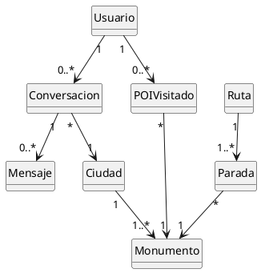

### 3.2 Diagrama de casos de uso detallado

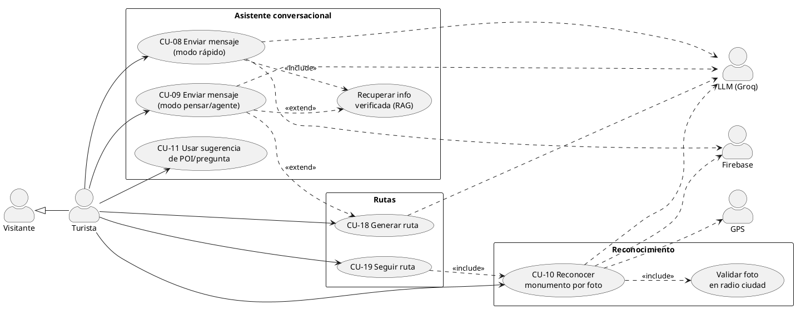

### 3.3 Descripción de los casos de uso

> Lista completa de casos de uso del sistema; se desarrollan en plantilla extendida los
> más representativos (CU-08, CU-09, CU-10, CU-18, CU-19). El resto quedan enumerados con
> su objetivo, trazables desde la matriz del Anexo A1.

| CU | Nombre | Actor | RF asociados |
|---|---|---|---|
| CU-01 | Registrarse | Visitante | RF-01, RF-02, RF-04 |
| CU-02 | Iniciar sesión | Visitante | RF-03, RF-04 |
| CU-03 | Cerrar sesión | Turista | RF-05 |
| CU-04 | Gestionar perfil (nombre/contraseña) | Turista | RF-06, RF-07 |
| CU-05 | Eliminar cuenta | Turista | RF-08 |
| CU-06 | Borrar mis datos | Turista | RF-09 |
| CU-07 | Gestionar permisos | Turista | RF-45, RF-46 |
| CU-08 | Enviar mensaje (modo rápido) | Turista | RF-10, RF-13, RF-14, RF-18 |
| CU-09 | Enviar mensaje (modo pensar) | Turista | RF-11, RF-12, RF-13, RF-15 |
| CU-10 | Reconocer monumento por foto | Turista | RF-19…RF-23, RF-27, RF-35 |
| CU-11 | Usar sugerencia (POI/pregunta) | Turista | RF-16 |
| CU-12 | Crear nueva conversación | Turista | RF-42, RF-44 |
| CU-13 | Abrir conversación del historial | Turista | RF-40, RF-41 |
| CU-14 | Eliminar conversación | Turista | RF-43 |
| CU-15 | Detectar ciudad por GPS | Turista | RF-24, RF-25 |
| CU-16 | Seleccionar ciudad manualmente | Turista | RF-26 |
| CU-18 | Generar ruta turística | Turista | RF-28…RF-31 |
| CU-19 | Seguir ruta parada a parada | Turista | RF-32, RF-33 |
| CU-20 | Registrar POI visitado | Turista | RF-34, RF-35 |
| CU-21 | Consultar estadísticas | Turista | RF-36 |
| CU-22 | Gestionar progreso (desmarcar/eliminar) | Turista | RF-37, RF-38 |

#### CU-08 — Enviar mensaje (modo rápido)

| Campo | Descripción |
|---|---|
| **Actor principal** | Turista |
| **Precondición** | Usuario autenticado. |
| **Disparador** | El usuario escribe un texto y pulsa enviar en modo rápido. |
| **Postcondición** | El mensaje del usuario y la respuesta del bot quedan persistidos en la conversación. |

**Flujo principal:**
1. El sistema verifica que hay ciudad activa; si no, la detecta por GPS o la solicita.
2. Crea la conversación si aún no existe.
3. Guarda el mensaje del usuario y deriva un título de la conversación.
4. Intenta detectar un monumento en el texto mediante alias/clases.
5. Si hay monumento (activo o mencionado), recupera el mejor fragmento del **RAG** y lo
   devuelve **directamente**, sin pasar por el LLM, junto con los POIs cercanos.
6. Si no hay monumento, invoca al LLM con el *system prompt* por defecto, el historial
   acotado y el texto del usuario.
7. Guarda la respuesta del bot y la muestra en tiempo real.

**Flujos alternativos:**
- *4a/5a — Cambio de contexto:* si el texto menciona un monumento distinto al activo, se
  cambia el contexto al mencionado.
- *6a — Error de servidor:* se guarda un mensaje de error amable y reintentable.
- *1a — Sin ciudad ni GPS:* se solicita selección manual y el envío se aborta hasta tenerla.

#### CU-09 — Enviar mensaje (modo pensar / agente)

| Campo | Descripción |
|---|---|
| **Actor principal** | Turista |
| **Precondición** | Usuario autenticado y modo «pensar» activo (o ruta activa). |
| **Disparador** | El usuario envía un texto en modo pensar. |
| **Postcondición** | Respuesta razonada persistida; opcionalmente datos de monumento o ruta. |

**Flujo principal:**
1. El servidor construye el contexto (system prompt de agente + ciudad + monumento activo
   + historial + prompt).
2. Realiza una **primera llamada** al LLM ofreciéndole las herramientas `usar_rag` y
   `generar_ruta`.
3. Si el LLM decide **no** usar herramientas, devuelve su respuesta directa.
4. Si decide usar `usar_rag`, el servidor ejecuta la búsqueda RAG del monumento, añade el
   resultado como mensaje de herramienta y hace una **segunda llamada** para sintetizar la
   respuesta final.
5. Si decide usar `generar_ruta`, el servidor calcula la ruta (vecino-cercano + 2-opt) y
   procede análogamente, devolviendo además los datos de la ruta.
6. La respuesta final (y, en su caso, `monumento_id`, POIs o ruta) se entrega al cliente.

**Flujos alternativos:**
- *2a — Excepción del LLM:* se devuelve error 500 y el cliente muestra mensaje amable.

#### CU-10 — Reconocer monumento por foto

| Campo | Descripción |
|---|---|
| **Actor principal** | Turista |
| **Precondición** | Permiso de cámara/galería; ciudad activa o detectable por GPS. |
| **Disparador** | El usuario captura o selecciona una imagen. |
| **Postcondición** | El monumento queda identificado, registrado como visitado y mostrado en la conversación. |

**Flujo principal:**
1. Si no hay ciudad, se detecta por GPS; si la hay, se valida que la foto está dentro del
   radio de la ciudad (**fail-open**).
2. La imagen se guarda de forma persistente y se muestra como mensaje del usuario.
3. El cliente envía la imagen al servidor (`/classify`).
4. El servidor preprocesa la imagen, extrae el *embedding* con DINOv2 (ONNX) y predice la
   clase con el clasificador; bajo umbral devuelve «desconocido».
5. Se mapea la clase a un monumento del catálogo y se obtienen descripción, coordenadas y
   POIs cercanos.
6. El cliente registra la visita (siembra el catálogo si es la primera vez y marca el POI),
   mejora el título de la conversación y muestra la respuesta con chips.

**Flujos alternativos:**
- *1a — Fuera de radio:* se informa y no se procesa la foto.
- *4a — No reconocido:* se responde indicando que no se ha identificado el lugar.

#### CU-18 — Generar ruta turística

| Campo | Descripción |
|---|---|
| **Actor principal** | Turista |
| **Precondición** | Ciudad activa; posición conocida (GPS o última foto). |
| **Disparador** | El usuario solicita una ruta y elige un filtro. |
| **Postcondición** | Se muestra el resumen de la ruta con paradas, tiempos y narración. |

**Flujo principal:**
1. El usuario inicia el flujo de ruta y fotografía el monumento donde se encuentra.
2. El sistema fija el punto de partida (GPS real o coordenadas del monumento).
3. El usuario selecciona el filtro: **todos**, **pendientes** o **visitados**.
4. El servidor filtra los monumentos, construye un orden con **vecino-más-cercano** y lo
   refina con **2-opt**.
5. Calcula distancia y tiempo a pie por tramo y el tiempo total, y genera un **resumen
   narrado** con el LLM.
6. El cliente muestra el resumen y ofrece comenzar la ruta.

**Flujos alternativos:**
- *4a — Sin candidatos:* se informa de que no hay monumentos para ese filtro.

#### CU-19 — Seguir ruta parada a parada

| Campo | Descripción |
|---|---|
| **Actor principal** | Turista |
| **Precondición** | Ruta generada y comenzada. |
| **Disparador** | El usuario fotografía el monumento de la parada actual. |
| **Postcondición** | Se avanza a la siguiente parada o se finaliza la ruta. |

**Flujo principal:**
1. El sistema anuncia la parada actual y pide una foto al llegar.
2. Al reconocer el monumento (CU-10), avanza automáticamente a la siguiente parada.
3. Repite hasta la última; al completarla, notifica el fin de la ruta.

### 3.4 Diagramas de secuencia de análisis

#### Secuencia de análisis — Conversación en modo rápido (CU-08)

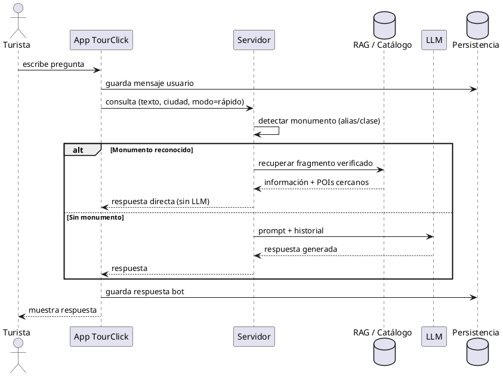

#### Secuencia de análisis — Modo pensar con herramientas (CU-09)

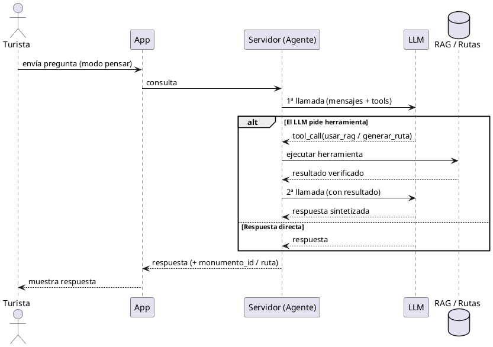

#### Secuencia de análisis — Reconocimiento por foto (CU-10)

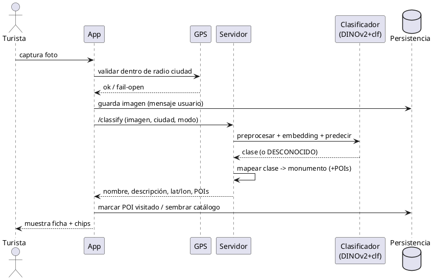

---

## 4. Diseño del sistema

### 4.1 Arquitectura general

TourClick es un sistema **cliente-servidor** con tres planos: el **cliente móvil/web**, el
**servidor de IA** y los **servicios externos en la nube**. El siguiente diagrama de
despliegue muestra los nodos y sus tecnologías:

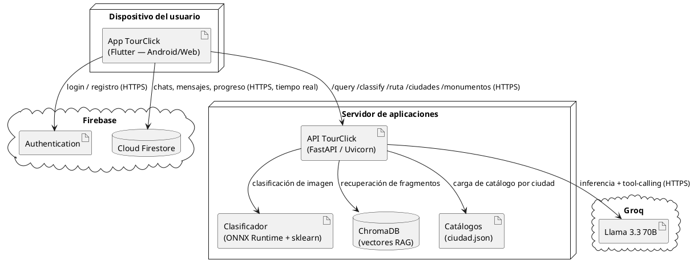

### 4.2 Diseño de la arquitectura del cliente (MVVM)

El cliente Flutter aplica **MVVM con Provider**. Las vistas (*Screens/Widgets*) observan
*ViewModels* (`ChangeNotifier`), que orquestan *Services* (singletons) que encapsulan el
acceso a Firebase, al backend, a la geolocalización y al almacenamiento local. Los
*Models* son clases planas con (de)serialización.

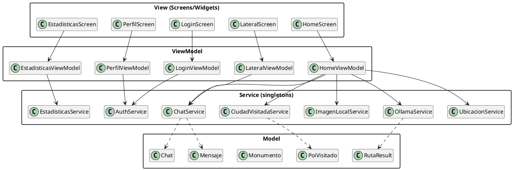

**Responsabilidades por capa:**

| Capa | Ubicación | Responsabilidad |
|---|---|---|
| View | `screens/`, `widgets/` | Presentación y captura de eventos; sin lógica de negocio. |
| ViewModel | `viewmodels/` | Estado de pantalla, orquestación de servicios, reglas de presentación (título, modos, estado de ruta). |
| Service | `services/` | Acceso a sistemas externos (Auth, Firestore, backend, GPS, disco). Singletons. |
| Model | `models/` | Entidades del dominio y (de)serialización `fromFirestore`/`toMap`/`fromMap`. |
| Router | `router/` | Navegación declarativa con guard de autenticación. |

### 4.3 Diseño de la arquitectura del servidor

El servidor FastAPI organiza la lógica en una capa de **endpoints** (en `main.py`) y una
capa de **servicios** especializados, más módulos de **RAG** y de **algoritmos de ruta**.

```plantuml
@startuml ArquitecturaServidor
skinparam packageStyle rectangle
hide empty members

package "API (main.py)" {
  class Endpoints <<FastAPI>> {
    +POST /query
    +POST /classify
    +POST /ruta
    +GET /monumentos
    +GET /ciudades
    +GET /health
  }
  class AgentePensar
  class AlgoritmoRuta <<2-opt + NN>>
}

package "Services" {
  class CiudadRegistry
  class MonumentoService
  class ClasificadorService
}

package "RAG" {
  class RagModule <<ChromaDB + SentenceTransformers>>
}

cloud "Groq LLM" as LLM

Endpoints --> CiudadRegistry
Endpoints --> AgentePensar
Endpoints --> AlgoritmoRuta
Endpoints --> RagModule
AgentePensar --> LLM
AgentePensar --> RagModule
AgentePensar --> AlgoritmoRuta
CiudadRegistry --> MonumentoService
CiudadRegistry --> ClasificadorService
AlgoritmoRuta --> MonumentoService
@enduml
```

**Responsabilidades:**

| Componente | Responsabilidad |
|---|---|
| `Endpoints` (main.py) | Definición de rutas REST (con y sin `/api`), modelos Pydantic y orquestación. |
| `AgentePensar` | Bucle de *tool-calling*: 1ª llamada al LLM, ejecución de herramienta, 2ª llamada de síntesis. |
| `AlgoritmoRuta` | Filtrado de monumentos, vecino-más-cercano, refinamiento 2-opt y cálculo de tiempos. |
| `CiudadRegistry` | Registro multi-ciudad: carga un `MonumentoService` por `ciudad.json` y resuelve alias de ciudad. |
| `MonumentoService` | Catálogo de una ciudad: índices por id/clase/alias, grafo de vecinos por Haversine, detección en texto. |
| `ClasificadorService` | Preproceso de imagen, *embedding* DINOv2 (ONNX), predicción sklearn y umbral de confianza. |
| `RagModule` | Embebido de la consulta y recuperación filtrada de fragmentos en ChromaDB. |

### 4.4 Diseño de la funcionalidad (secuencias de diseño)

#### Secuencia de diseño — Modo pensar con `usar_rag` (CU-09)

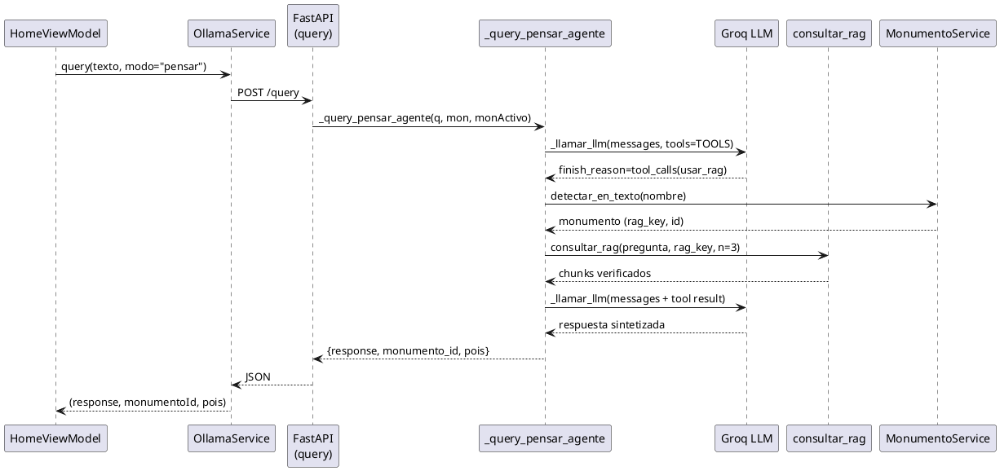

#### Secuencia de diseño — Generación de ruta (CU-18)

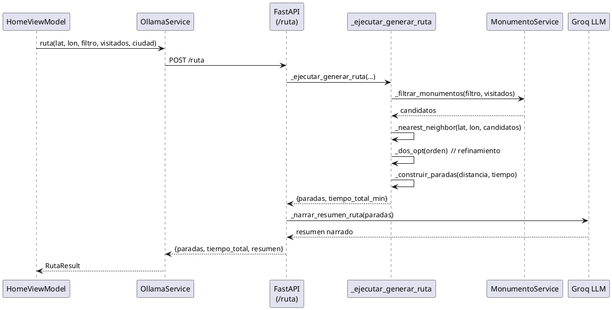

#### Máquina de estados — Flujo de ruta (lado cliente)

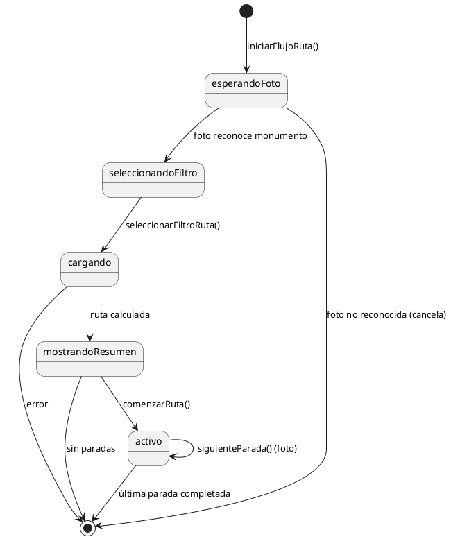

### 4.5 Diseño de interfaces

#### 4.5.1 Interfaz de servicios (API REST)

| Método | Ruta | Entrada | Salida |
|---|---|---|---|
| `POST` | `/query`, `/api/query` | `prompt, system?, ciudad?, history[], monumento_id?, modo, lat?, lon?, visitados[]` | `response, modo, monumento_id, pois_cercanos[], ruta?` |
| `POST` | `/ruta`, `/api/ruta` | `lat, lon, filtro, visitados[], ciudad?` | `paradas[], tiempo_total_min, resumen` |
| `POST` | `/classify`, `/api/classify` | `imagen (multipart), modo, ciudad?` | `clase, id?, nombre, descripcion_corta?, lat?, lon?, pois_cercanos[]` |
| `GET` | `/monumentos`, `/api/monumentos` | `ciudad?` (query) | `monumentos[] {id, nombre}` |
| `GET` | `/ciudades`, `/api/ciudades` | — | `ciudades[] {id, nombre, lat, lon, radio_km}` |
| `GET` | `/health`, `/api/health` | — | `status` |

**Contratos relevantes (modelos):**

- *Query* — petición de conversación. `modo ∈ {rapido, pensar}`; `history` es la lista
  acotada de los últimos mensajes de texto.
- *RutaRequest* — `filtro ∈ {todos, visitados, pendientes}`.

El cliente abstrae estos contratos en `OllamaService`, que además implementa **tolerancia
de URL**: ante un 404 prueba la variante del endpoint con/sin `/api`.

#### 4.5.2 Interfaz de usuario (navegación)

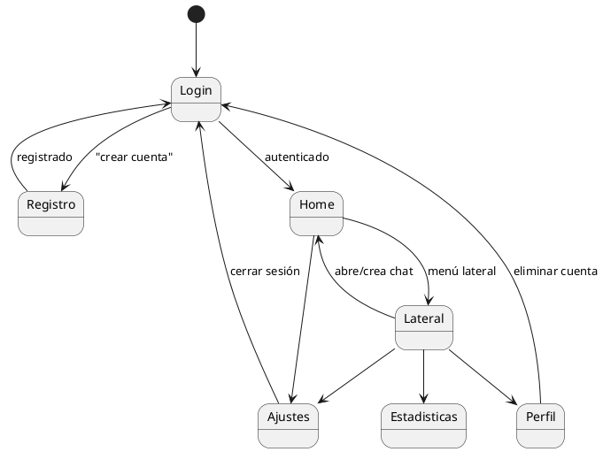

Pantallas principales: **Login/Registro**, **Home** (chat con barra de entrada: texto,
cámara, modo, ruta), **Lateral** (historial de chats, ciudades visitadas, acceso a perfil),
**Perfil** (nombre, contraseña, borrar datos, eliminar cuenta), **Estadísticas** (totales y
progreso por ciudad), **Ajustes** (permisos y cierre de sesión).

### 4.6 Diseño de datos

La persistencia se reparte en tres almacenes según su naturaleza:

**1. Cloud Firestore** — datos del usuario en tiempo real:

```
users/{uid}                                  → { nombre, email }
users/{uid}/chats/{chatId}                   → { titulo, ciudad, fechaCreacion, userId }
users/{uid}/chats/{chatId}/mensajes/{msgId}  → { tipo, role, contenido?, imgUrl?,
                                                 fecha, poisCercanos[] }
users/{uid}/ciudades_visitadas/{ciudadId}    → { nombre, visitadaEn }
users/{uid}/ciudades_visitadas/{ciudadId}/pois/{poiId}
                                             → { nombre, visitado, visitadoEn? }
monumentos/{ciudadId}                        → { nombre, lat, lon, radio_km }
monumentos/{ciudadId}/items/{poiId}          → { nombre, descripcionCorta, lat, lon,
                                                 alias[], classifierClass }
```

> El `chatId` se genera con prefijo *timestamp* UTC para ordenación cronológica natural.
> El catálogo `monumentos/` se publica con el script `upload_monumentos.py`.

**2. ChromaDB** (servidor) — base vectorial del RAG: colección `monumentos_salamanca` con
fragmentos de texto indexados por `monumento` (clave `rag_key`), consultados por
similitud de *embeddings* multilingües.

**3. Sistema de ficheros** (servidor y dispositivo):
- Servidor: catálogo por ciudad (`data/ciudades/<id>/ciudad.json`) y modelos
  (`models/*.onnx`, `*.pkl`, `*.npy`, `meta_*.json`).
- Dispositivo: imágenes capturadas, copiadas a almacenamiento persistente por
  `ImagenLocalService` (no a la caché temporal).

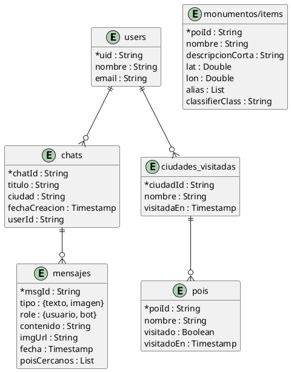

---

## 5. Decisiones de diseño y patrones

| Decisión | Justificación |
|---|---|
| **MVVM + Provider** en el cliente | Separa presentación, estado y acceso a datos; facilita pruebas y mantenibilidad (RNF-22). |
| **Servicios singleton** | Punto único de acceso a recursos externos (Auth, Firestore, backend, GPS), reduce acoplamiento de las vistas. |
| **Doble modo (rápido / pensar)** | Equilibra latencia y profundidad: el modo rápido evita el LLM cuando hay RAG (RNF-06); el pensar habilita el agente. |
| **Agente con *tool-calling*** | Delega en el LLM la decisión de cuándo recuperar información o generar ruta, manteniendo respuestas fundamentadas (RF-12, RF-13). |
| **RAG sobre ChromaDB** | Fundamenta las respuestas en información verificada y reduce alucinaciones (HU-10). |
| **Vecino-cercano + 2-opt** | Solución de calidad casi óptima al TSP para catálogos pequeños, en tiempo instantáneo (RNF-08). |
| **Registro multi-ciudad** | Permite añadir ciudades cargando un `ciudad.json` sin tocar código (RNF-23). |
| **Tolerancia de URL y catálogo de respaldo** | Robustez frente a despliegues y caídas (RNF-10, RNF-11). |
| **Política *fail-open* de GPS** | Prioriza no bloquear al usuario ante fallos de ubicación (RNF-12). |
| **Blindaje del *system prompt*** | Protege la identidad del asistente frente a *prompt injection* (RF-17, RNF-17). |
| **Títulos por niveles** | Garantiza títulos representativos y estables sin sobrescrituras indeseadas (RN-04). |

---

> **Documentos relacionados:** [A1 — Especificaciones](./A1_especificaciones.md) ·
> [Modelo de dominio](./modelo_dominio.md)
