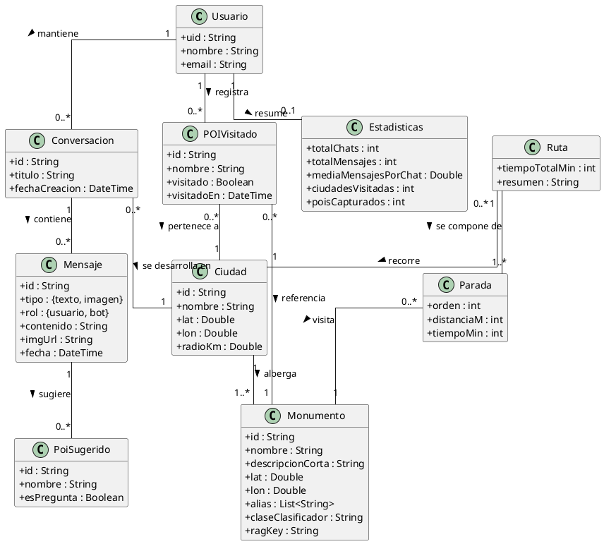

# Modelo de dominio — TourClick

> Documento compartido. Sirve de base para el **Anexo A2 (Análisis y diseño)** y es
> reutilizable por el resto de anexos del proyecto. Describe los conceptos del dominio
> del problema (vocabulario, entidades y relaciones) con independencia de la tecnología
> concreta de almacenamiento. Las particularidades de persistencia (Firestore, ChromaDB,
> ficheros) se detallan en el apartado *Diseño de datos* del Anexo A2.

## Índice

1. [Propósito](#1-propósito)
2. [Glosario del dominio](#2-glosario-del-dominio)
3. [Diagrama del modelo de dominio](#3-diagrama-del-modelo-de-dominio)
4. [Catálogo de entidades](#4-catálogo-de-entidades)
5. [Relaciones y reglas de dominio](#5-relaciones-y-reglas-de-dominio)
6. [Estados relevantes](#6-estados-relevantes)

---

## 1. Propósito

TourClick es una aplicación de turismo cultural para ciudades españolas (actualmente
**Salamanca**) que permite a un visitante conversar con un guía turístico virtual
(**Clicky**), **reconocer monumentos a partir de una fotografía**, **generar rutas a pie**
por el patrimonio de la ciudad y llevar un **registro de progreso** de los lugares
visitados. Este documento fija el vocabulario y las entidades del dominio que manejan
tanto la aplicación móvil como el servidor.

## 2. Glosario del dominio

| Término | Definición |
|---|---|
| **Visitante / Turista** | Persona que usa la aplicación. Cuando se autentica pasa a ser un usuario con cuenta. |
| **Clicky** | Personaje/identidad del asistente conversacional de IA. Es un guía turístico especializado en monumentos y patrimonio. |
| **Conversación (Chat)** | Hilo de mensajes entre el usuario y Clicky, asociado a una ciudad y con un título derivado de su contenido. |
| **Mensaje** | Unidad de una conversación. Puede ser de **texto** o de **imagen**, y proceder del **usuario** o del **bot**. |
| **Monumento / POI** | Punto de interés patrimonial de una ciudad (catedral, plaza, escultura, leyenda…). Es la pieza central del dominio. |
| **Ciudad soportada** | Ciudad para la que el sistema dispone de catálogo de monumentos, modelo de reconocimiento y datos geográficos (centro + radio). |
| **Modo rápido** | Modo de conversación que responde con baja latencia: emparejado de alias + recuperación directa de información (RAG). |
| **Modo pensar** | Modo de conversación «agente»: el LLM razona y decide invocar herramientas (`usar_rag`, `generar_ruta`) antes de responder. |
| **RAG** | *Retrieval-Augmented Generation*. Recuperación de fragmentos verificados de información sobre un monumento para fundamentar la respuesta del LLM. |
| **Reconocimiento (clasificación)** | Identificación del monumento que aparece en una fotografía mediante un modelo de visión por computador. |
| **Ruta** | Itinerario a pie ordenado por proximidad que recorre un subconjunto de monumentos de la ciudad. |
| **Parada** | Cada monumento de una ruta, con su distancia y tiempo estimado a pie respecto a la parada anterior. |
| **POI visitado** | Monumento que el usuario ha capturado con la cámara al menos una vez; alimenta el progreso y las estadísticas. |
| **Progreso** | Fracción de monumentos capturados sobre el total del catálogo de una ciudad. |
| **Alias** | Nombre alternativo de un monumento usado para detectarlo dentro del texto del usuario. |
| **Clase del clasificador** | Etiqueta que devuelve el modelo de visión y que se mapea a un monumento del catálogo. |

## 3. Diagrama del modelo de dominio

## 4. Catálogo de entidades

### Usuario
Persona registrada en el sistema. Se identifica por un `uid` único (proporcionado por
el proveedor de autenticación), un nombre visible y un correo electrónico. Es el
propietario de sus conversaciones y de su progreso; ningún usuario puede acceder a los
datos de otro.

### Ciudad
Ciudad turística soportada. Define su centro geográfico (`lat`, `lon`) y un `radioKm`
que delimita su área de cobertura. Una ciudad solo se considera soportada si dispone de
catálogo de monumentos y de modelo de reconocimiento.

### Monumento (Punto de Interés)
Elemento patrimonial de una ciudad. Además de los datos descriptivos y geográficos,
mantiene:
- **alias**: variantes textuales para detectarlo en lo que escribe el usuario.
- **claseClasificador**: etiqueta que produce el modelo de visión.
- **ragKey**: clave con la que están indexados sus fragmentos de información en el RAG.

### Conversación (Chat)
Hilo de diálogo de un usuario con Clicky. Pertenece a una ciudad y tiene un título que
el sistema deriva automáticamente (a partir del primer texto significativo o del
monumento fotografiado). Ordena sus mensajes cronológicamente.

### Mensaje
Intervención dentro de una conversación. Atributos clave: **tipo** (`texto` | `imagen`),
**rol** (`usuario` | `bot`), contenido o URL de imagen, fecha y, opcionalmente, una lista
de **POIs sugeridos** (chips de monumentos cercanos o de preguntas).

### POI sugerido
Sugerencia interactiva que acompaña a un mensaje del bot: bien un monumento cercano al
que saltar, bien una pregunta predefinida (curiosidad). Cuando `esPregunta` es verdadero,
su `nombre` es directamente el texto de la pregunta.

### POI visitado
Registro de que un usuario ha capturado un monumento con la cámara. Se siembra a partir
del catálogo de la ciudad (todos a `visitado = false`) y se marca al reconocer el
monumento por foto. Es la base de la gamificación y de las estadísticas de progreso.

### Ruta y Parada
Una **Ruta** es un itinerario a pie generado para una ciudad: una secuencia ordenada de
**Paradas**, cada una con la distancia y el tiempo a pie estimados desde la anterior, más
un resumen narrado y el tiempo total. Es un objeto **efímero de sesión** (no se persiste:
se reconstruye bajo demanda).

### Estadísticas
Vista agregada del usuario: número de conversaciones, de mensajes, media de mensajes por
chat, ciudades visitadas, POIs capturados y progreso por ciudad. Se calcula bajo demanda
a partir del resto de entidades.

## 5. Relaciones y reglas de dominio

- **RD-01** — Toda conversación pertenece a **un** usuario y a **una** ciudad.
- **RD-02** — Un mensaje pertenece a **una** conversación y es inmutable una vez creado.
- **RD-03** — Un monumento pertenece a **una** ciudad; su `claseClasificador` y sus
  `alias` son únicos dentro de la ciudad.
- **RD-04** — Un POI visitado referencia a un monumento del catálogo de su ciudad; un
  usuario tiene como mucho **un** registro de visita por monumento y ciudad.
- **RD-05** — El progreso de una ciudad es `capturados / total`, siendo `total` el tamaño
  del catálogo de monumentos sembrado para esa ciudad.
- **RD-06** — Una ruta solo contiene monumentos de la ciudad activa y compatibles con el
  filtro elegido (`todos`, `visitados`, `pendientes`).
- **RD-07** — Una fotografía solo se acepta si el dispositivo se encuentra dentro del
  `radioKm` de la ciudad activa (con política *fail-open* si no puede validarse el GPS).
- **RD-08** — El título de una conversación nunca «empeora»: solo se sustituye por otro de
  mayor nivel de calidad (sin título → genérico → significativo).

## 6. Estados relevantes

El concepto de **Ruta** atraviesa un ciclo de vida explícito durante la sesión, modelado
como una máquina de estados (ver detalle en el Anexo A2):

`esperandoFoto → seleccionandoFiltro → cargando → mostrandoResumen → activo → (fin)`

El resto de entidades (Usuario, Conversación, Mensaje, POI visitado) son entidades de
datos sin máquina de estados propia más allá de su creación, actualización y borrado.
